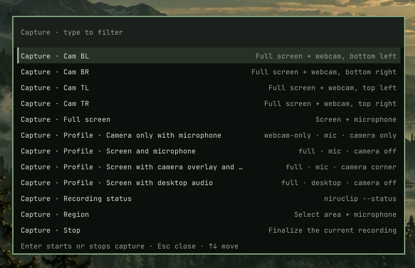

# NIRUCLIP

Screen, region and camera recorder for the NIRUX X11 desktop.

**Status: alpha** · Part of the [NIRUX](https://github.com/nirucon/nirux) suite · [MIT License](LICENSE)



*Capture profiles as they appear in NIRU Launcher (`nirulauncher --clip`).*

## About

NIRUCLIP is a small native X11 recorder. It owns the recording process and a
versioned state file; ffmpeg does the encoding and `slop` selects a rectangle.
It does not upload anything and runs no background daemon: a recording is one
process that lives exactly as long as the recording.

In NIRUX you normally start it from the recording view of NIRU Launcher, and
NIRUBAR shows the running, paused, interrupted or failed recording.

## Features

- Full screen, region, window rectangle or camera-only recording.
- Microphone, desktop audio or both (mixed at unity gain with a peak limiter).
  The microphone can be chosen per recording or profile (the webcam mic, an
  audio interface input) without changing the system default.
- Camera overlay in any corner at three sizes, rounded, circular or square,
  with a thin border in the NIRUX theme colour and optional mirroring; or
  camera only.
- The camera is captured at a proper size (MJPEG 720p for the overlay,
  1080p camera-only) on one shared clock with the screen and microphone, so
  the face stays in sync with the voice.
- Camera health checks: the countdown and the running recording detect a
  privacy image (for example HP's crossed-out camera), a frozen picture, a
  camera that delivers no frames or one that another program is using, and
  say so in a notification, `--status`, NIRUBAR and NIRU Launcher. The
  check runs with every countdown, also a short one.
- Camera recovery: a camera that is unplugged or stops delivering frames
  mid-recording no longer freezes the overlay. A screen recording continues
  without the camera at once and takes it back when it returns within 10 s;
  a camera-only recording waits up to 10 s for it and otherwise saves what
  was recorded. A camera that shows its firmware placeholder is closed and
  reopened in another mode (twice by default) before NIRUCLIP warns. The
  result is always one playable file.
- `--check-camera` and a live `--preview` of the overlay.
- `--export mp4|gif` (with `--from`/`--to` trimming) and `--share` through
  NIRU Share.
- `share`, `small` and `quality` presets that never upscale a smaller screen.
- VAAPI hardware encoding when a probe succeeds, with automatic software
  (`libx264`) fallback.
- Pause and resume with a lossless join of the segments on stop.
- Crash-safe output: `.part.mkv` files, validation before rename, and
  `--recover` for interrupted recordings, including a lossless remux after a
  power loss.
- Saved profiles plus four built-ins, and a configurable default profile.
- Free-space checks: a warning below 2 GB, a clean stop below 500 MB.
- Frame drop/duplication monitoring in `--status` and NIRUBAR.
- Countdown, start and result notifications.

## Requirements

- X11 (Debian, Arch and Void glibc, x86_64). The released binary is a static
  x86_64 musl build.
- `ffmpeg` (with `ffprobe`), `slop` for region capture, `xrandr`.
- For camera and microphone: a V4L2 camera, `v4l2-ctl` (`v4l-utils`) and
  PipeWire's PulseAudio interface.
- Optional: `notify-send`, a VAAPI driver for hardware encoding.

NIRUX installs the matching packages.

## Installation

### With NIRUX

NIRUCLIP is a core component: `nirux install` and `nirux update` install and
update it as part of the pinned suite generation.

### Standalone

```sh
./install.sh            # download the released static binary, verify SHA256SUMS, install to ~/.local/bin
./install.sh --build    # build from this checkout with cargo and install it
```

`NIRUCLIP_PREFIX` changes the prefix (default `~/.local`); `NIRUCLIP_VERSION`
installs another release.

## Usage

```sh
niruclip --full --audio mic
niruclip --region --audio both
niruclip --full --audio mic --mic webcam     # this recording only
niruclip --list-mics
niruclip --full --audio mic --mic UMC1820 --mic-channels 3     # input 3 as mono
niruclip --full --audio mic --mic UMC1820 --mic-channels 1,2   # inputs 1 and 2 as stereo
niruclip --full --webcam corner --corner bottom-right --webcam-size large
niruclip --webcam-only --audio mic
niruclip --profile screen-camera
niruclip --pause
niruclip --resume
niruclip --stop
niruclip --status
niruclip --status --json
niruclip --recover
niruclip --list-profiles
niruclip --full --audio desktop --save-profile demo
niruclip --check-camera
niruclip --preview --camera-shape circle --mirror
niruclip --export mp4
niruclip --export gif --from 3 --to 9
niruclip --share
```

| Option | Values |
|---|---|
| Mode | `--full`, `--region`, `--window`, `--webcam-only` |
| Audio | `--audio none`, `mic`, `desktop`, `both` |
| Microphone | `--mic SOURCE` or `default` (default: the system default source); `--list-mics [--json]` |
| Microphone inputs | `--mic-channels N` (one input as mono), `N,M` (a pair as stereo) or `all` (default: the source as before) |
| Camera | `--webcam off`, `corner`, `only` |
| Corner | `--corner top-left`, `top-right`, `bottom-left`, `bottom-right` |
| Camera size | `--webcam-size small`, `medium` (default), `large`: 20, 26 or 34 % of the video height |
| Camera device | `--camera DEVICE` or `auto` (default: the first camera, infrared sensors skipped) |
| Camera shape | `--camera-shape rounded` (default), `circle`, `rect` |
| Camera border | `--camera-border theme` (default), `none`, or a hex colour such as `8aa87e` |
| Mirroring | `--mirror`, `--no-mirror` (default: not mirrored, so text reads correctly) |
| Export | `--export mp4\|gif`, `--input FILE`, `--from SECONDS`, `--to SECONDS`; `--share` |
| Preset | `--preset share` (up to 1080p), `small` (up to 720p), `quality` |
| Encoder | `--encoder auto` (default), `software`, `vaapi` |
| Countdown | `--countdown 0..10` |
| Output | `--output PATH` (file or directory) |
| Screen | `--screen OUTPUT` (connected RandR output for full/overlay) |
| Profile | `--profile NAME` |
| Notifications | `--no-notify` |

`--full` records the primary RandR output. `--window` currently records a
selected static rectangle; it does not follow a window that moves or resizes.

Recordings go to `~/Videos/NIRUCLIP-YYYY-MM-DD_HH-MM-SS.mkv` unless
`NIRUCLIP_OUTPUT` or `--output` says otherwise. Existing files are never
overwritten.

The details of encoding, pause/resume, recovery, the state file, audio mixing,
disk-space checks and exit codes are in [docs/REFERENCE.md](docs/REFERENCE.md).

## Configuration

Profiles live in `${XDG_CONFIG_HOME:-$HOME/.config}/niruclip/config.toml`.
Built-in profiles:

| Profile | Capture |
|---|---|
| `screen-mic` | Full screen and microphone |
| `screen-camera` | Full screen with camera overlay and microphone |
| `camera-mic` | Camera only with microphone |
| `screen-desktop` | Full screen with desktop audio |

`--save-profile NAME` saves the current choices (letters, digits, dot, dash and
underscore). A `default_profile` applies when no `--profile` is given;
command-line options still override it.

```toml
schema = 1
default_profile = "screen-mic"
encoder = "auto"            # auto, software or vaapi
mic = "default"             # optional: default, a source name or part of its description

[profiles.demo]
description = "Custom capture profile"
mode = "full"               # full, region, window, webcam-only
audio = "desktop"           # none, mic, desktop, both
mic = "UMC1820"             # optional; absent means the system default source
mic_channels = "1,2"        # optional: N (mono), N,M (stereo) or all
webcam = "off"              # off, corner, only
corner = "bottom-right"
webcam_size = "medium"      # small, medium, large
preset = "share"            # share, small, quality
countdown = 3
screen = "DisplayPort-0"    # optional
camera = "/dev/v4l/by-path/pci-0000:c4:00.4-usb-0:1:1.0-video-index0"  # optional
camera_shape = "circle"     # rounded, circle, rect
camera_mirror = false
camera_border = "theme"     # theme, none or RRGGBB
```

### Choosing the microphone

`niruclip --list-mics` lists the input sources (sink monitors are left out)
with their PipeWire/Pulse name and description; `*` marks the system default.
`--mic` (or `mic =` at the top of the config or in a profile) takes a source
name, a case-insensitive part of the description such as `webcam` or
`UMC1820`, or `default`. Precedence: `--mic`, then the profile, then the
top-level `mic`; without any of them the system default source is used, as
before. The choice applies to `--audio mic` and to the microphone half of
`--audio both`; the system default is never changed.

A profile with the name of a built-in one changes only the keys it sets, so
this keeps the camera overlay of `screen-camera` and only picks the mic:

```toml
[profiles.screen-camera]
mic = "webcam"
```

If the chosen microphone is not there (unplugged), NIRUCLIP warns with a
notification and records from the system default instead of failing;
`--status` and `session.json` (`mic`) show which source was used and why.

### Inputs of a multichannel interface

An audio interface such as the Behringer UMC1820 shows up as one source with
many channels (18, named AUX0 to AUX17). `--list-mics` prints the channel count
and names under each microphone and, only for sources with more than two
channels, how to pick inputs. `--mic-channels 3` records input 3 alone as
mono, `--mic-channels 1,2` (or `1+2`) records inputs 1 and 2 as left and right.
Inputs are numbered from 1, like the labels on the interface. The key
`mic_channels` works at the top of the config and in profiles, with the same
precedence as `mic`; `all` or no setting records the source as before.

The mapping happens only inside the recording: ffmpeg opens every channel of
the source and keeps the chosen ones. No PipeWire node is created, the system
default and the routing are not changed, and nothing is left behind after the
recording. If the source has fewer inputs than asked for, the channel layout
cannot be read (`pw-dump` from PipeWire), or the chosen microphone is missing,
NIRUCLIP notifies and records the microphone as usual. If the interface
disappears during a recording, the recording continues and is saved; the
chosen inputs are silent from then on.

`camera`, `camera_shape`, `camera_mirror` and `camera_border` can also be set
at the top level as defaults for every recording.

Camera recovery is set at the top level. Every key is optional; a missing
key means its default, so older configs work unchanged:

```toml
camera_reconnect_seconds = 10     # wait for a lost camera; 0 = off (0.4.0 behaviour)
camera_stall_seconds = 2          # no new camera frame this long = lost (0.5..30)
camera_reopen_attempts = 2        # reopens on a placeholder/frozen picture; 0 = only warn
camera_reopen_autosuspend = true  # keep USB autosuspend off while reopening, if allowed without root
``` A `/dev/v4l/by-path/` link
keeps pointing at the same USB port; on some laptops the `by-id` link
`...-video-index0` is the infrared sensor, not the camera.

Notifications are shown when `notify-send` is available; `--no-notify` or
`NIRUCLIP_NOTIFY=0` disables them. Other environment overrides are listed in
the [reference](docs/REFERENCE.md#environment-overrides).

## Files and paths

| Path | Purpose |
|---|---|
| `~/.local/bin/niruclip` | The program |
| `~/.config/niruclip/config.toml` | Profiles, default profile, encoder |
| `~/.local/state/niruclip/session.json` | Recording state (schema 1), read by NIRUBAR and NIRU Launcher |
| `~/.local/state/niruclip/vaapi-probe.json` | Cached VAAPI probe result per boot |
| `~/.local/state/niruclip/camera-cache.json` | Cached camera capabilities per device node and boot |
| `~/Videos/NIRUCLIP-*.mkv` | Recordings (`*.part.mkv` while recording); `--export` writes `.mp4`/`.gif` next to them |
| `$XDG_RUNTIME_DIR/niruclip-PID.pgm` | A 128x96 grey copy of the current camera frame while recording (tmpfs, removed at the end) |

Recordings, partials and profiles are user data. NIRUCLIP never deletes a
personal recording as cleanup.

## Troubleshooting

- **A recording ended unexpectedly:** run `niruclip --status`, then
  `niruclip --recover`. Segments of a paused recording are joined too.
- **The camera shows a crossed-out camera or a black picture:** that is the
  camera's own privacy image. Press the camera/privacy key (on HP laptops
  often F10 or a key with a camera symbol), open the shutter, or check the
  BIOS camera setting. `niruclip --check-camera` tells you when the picture
  is usable again. NIRUCLIP already closes and reopens the camera (in
  another mode) before it warns; `camera_events` in `--status --json` shows
  what it tried.
- **The camera was unplugged during a recording:** a screen recording goes
  on without it and picks it up again when it is plugged back in within
  `camera_reconnect_seconds`; a camera-only recording is saved when it does
  not come back. The saved file is one video; each switch shows as a short
  jump of about 1-2 s.
- **"Camera is in use by ...":** another program (a browser or a video call)
  is streaming from the camera. Close it, or record without the camera.
- **Choppy camera overlay:** check `--status` for the drop warning. NIRUCLIP
  requests 30 fps. In low light many cameras halve their rate; set
  `camera_steady_framerate = true` to turn their dynamic exposure framerate
  off during capture (not on HP 5MP laptop cameras: they show their privacy
  image then).
- **Hardware encoding not used:** `--status` shows the encoder and any
  fallback. Delete `vaapi-probe.json` after a driver change, or force
  `--encoder software`.
- **Recording refused to start:** less than 500 MB was free in the output
  directory.

## Uninstall

With NIRUX, NIRUCLIP is removed by `nirux uninstall`. A standalone copy is one
file: `rm ~/.local/bin/niruclip`. Configuration and state are in
`~/.config/niruclip` and `~/.local/state/niruclip`; recordings are never
removed.

## Building from source

```sh
cargo test --locked
cargo clippy --locked --all-targets -- -D warnings
cargo build --release --locked
sh tests/lifecycle.sh target/release/niruclip
sh tests/smoke.sh target/release/niruclip
```

The tests use fake ffmpeg/ffprobe and synthetic geometry. The real camera, audio
and display matrix is run on a graphical test machine.

## Status, disclaimer and how it's made

**Status: alpha.** Recording, pause/resume and recovery work on my machines,
but `--window` is still a static rectangle and the camera/audio matrix depends a
lot on hardware.

NIRUX and every niru* project are made by me, Nicklas Rudolfsson
([@nirucon](https://github.com/nirucon)), for me. They are tailored to my own
needs, preferences and workflows, on my own machines. If they fit yours too,
that's a nice bonus.

- **Free and open source.** Anyone is free to use, study, change and share
  it under the [MIT License](LICENSE).
- **No guarantees.** There is no warranty of any kind. Use it at your own
  risk, read what you install and keep backups of anything that matters.
- **How it's made.** Some of these projects I built from scratch by hand. In
  more recent releases I have used Claude, Anthropic's AI, to do much of the
  heavy lifting under my direction: I decide what to build and how it should
  behave, and I test it on my own machines. It saves me a lot of time, and
  the result is quite OK.
- **Alpha, beta, dev, and maybe forever.** Most things here are alpha, beta
  or dev, and may stay that way. Maybe one day there will be a real stable
  release, but given how fast development moves, and how I am as a person,
  maybe never :)

| Label | Meaning |
|---|---|
| dev | Under active construction; may not build, install or work yet. |
| alpha | Works on my machines, but incomplete or rough; expect breaking changes. |
| beta | In daily use on my machines and mostly complete; rough edges remain. |

## License

MIT License, see [LICENSE](LICENSE). Copyright (c) 2026 Nicklas Rudolfsson.
